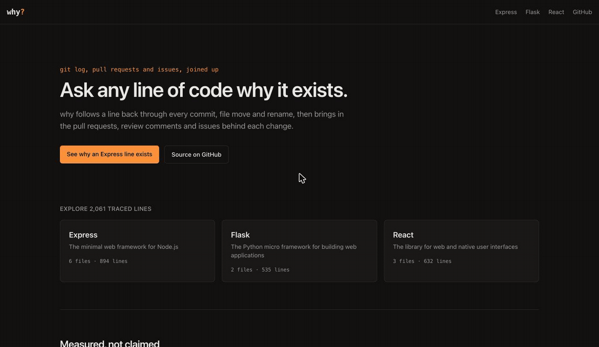
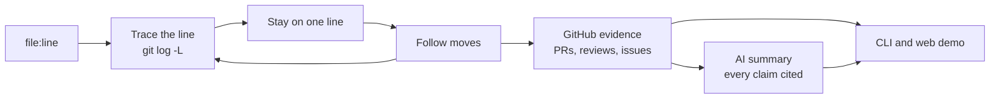

# why

**Ask any line of code why it exists.**

[](https://github.com/ZaYnnnnnnn/why/actions/workflows/ci.yml)
[](https://zaynnnnnnn.github.io/why/)

`why` follows a line of code back through every commit that shaped it, across edits, file moves
and renames. It links each change to its pull request, the reviewers' comments on that file and the
issues behind it, so you can see the reasons, not just the diffs.

**[Try the live demo](https://zaynnnnnnn.github.io/why/)**: click any marked line in Express, Flask
or React. Nothing to install.



## Example

```text
$ why lib/response.js:72

lib/response.js:72
      throw new RangeError(`Invalid status code: ${JSON.stringify(code)}. Status code must be ...`);

723b545  2024-07-30  Jon Church
  Throw on invalid status codes (#4212)
  added at line 78
  PR #4212  Throw on invalid status codes  (merged 2024-07-30, @jonchurch)
    review @LinusU: Hmm, Node.js documents their value as `number` and doesn't mention that strings…
    review @blakeembrey: Should we continue `JSON.stringify` here so it's easier to debug a string…
  closes PR #3143  Gracefully handle invalid status codes  (closed)
  mentions expressjs/discussions#233  Express 5.0 - last push!  (closed)

Sources: 1 commit, 1 pull request, 2 issues
```

A line with a longer story, Express `res.status`:

```text
bb53b20  2015-06-20  perf: remove argument reassignments in response prototype
           - res.status = function(code){
           + res.status = function status(code) {
           PR #2682  Release 4.13  (batch of 40 commits)
61ce6c5  2011-11-10  misc
           moved to line 39 from lib/response.js:149
b04be51  2011-06-28  Added chainable res.status(code)
           + res.status = function(code){
```

Plain `git log -L` stops at the 2011 "misc" commit and calls it the origin. `why` sees that
the block was moved there from line 149 and keeps going to the real origin.

## How it works



1. **Trace the line.** `git log -L` lists every commit that changed the line, and keeps track of
   it as lines above it are added or removed. File renames are followed automatically.
2. **Stay on one line.** When an old commit collapsed several lines into ours, git starts tracking
   all of them. `why` picks the old line most similar to ours and restarts on that single line. If
   none is at least 50% similar, the line replaced unrelated code and the trail ends there.
3. **Follow moves.** When git says a line was "added", `why` checks whether the same commit removed
   a matching line somewhere else, using the neighbouring lines to be sure. If so, the step is a
   **move** and the trace continues from the old place. If two places match equally well, it says
   so instead of guessing.
4. **Bring in GitHub.** For each commit: its pull request, the review comments on this file, and the
   issues it closes or mentions. Release pull requests that bundle many unrelated commits are
   labelled, so their issue lists are not mistaken for this line's reasons. Everything is cached,
   and a free read-only token raises GitHub's limit from 60 to 5,000 requests an hour.
5. **Explain (optional).** `--explain` asks Claude for a short summary in which every claim must
   cite a real commit, pull request, review or issue. Answers that fail the check are not shown, and
   the model lists what the evidence does not say instead of guessing.

The full walk-through, with every problem we hit, a map of the code and a glossary, is in
**[docs/how-it-works.md](docs/how-it-works.md)**.

## Accuracy

Measured on 30 lines picked at random from Express, Flask and React, with the true history of each
worked out by hand using a different method from `why`'s ([`eval/`](eval)):

| Measure                                              | Result          |
| ---------------------------------------------------- | --------------- |
| Trail ends at the true origin                        | **20/30 (67%)** |
| Newest step is the last commit that touched the line | 30/30           |
| Trail follows the wrong line                         | 0/30            |
| Time per line                                        | median 0.6 s    |

It handles renames, moves, identical lines elsewhere in a file and multi-line statements. It does
not yet follow code that was **copied** to a new file, lines **split** by reformatting, large
**rewrites**, or a line that was **reverted and re-landed**. Every miss is explained in
[decision 0007](docs/decisions/0007-measuring-accuracy.md).

## In your editor

The **why: line history** extension brings the same panel into VS Code, Cursor and Windsurf:
right-click any line → **Why does this line exist?**, or click **Why?** above a function. It
works on your own repositories (private ones too), maps unsaved edits back to the last commit, and
uses the editor's GitHub login.

Download `why-line-history.vsix` from the latest
[release](https://github.com/ZaYnnnnnnn/why/releases) and run **Extensions: Install from VSIX…**.
Details in the [extension README](apps/vscode/README.md).

## Use it

Requires Node 22.18+, pnpm and git.

```bash
git clone https://github.com/ZaYnnnnnnn/why.git
cd why && pnpm install
alias why="node $PWD/apps/cli/src/main.ts"
```

Then, inside any git repository:

```bash
why src/app.ts:42
```

| Option                  | What it does                                                                                                           |
| ----------------------- | ---------------------------------------------------------------------------------------------------------------------- |
| `--explain`             | Add an AI summary that cites the evidence (`--ai claude-cli` by default, or `--ai anthropic` with `ANTHROPIC_API_KEY`) |
| `--json`                | Machine-readable output                                                                                                |
| `--rev <rev>`           | Start from an older commit, branch or tag                                                                              |
| `--repo <path>`         | Run against another folder                                                                                             |
| `--github <owner/repo>` | Choose the GitHub repository instead of reading the git remotes                                                        |
| `--no-github`           | Git history only                                                                                                       |
| `--refresh`             | Ignore cached GitHub answers                                                                                           |

Set `GITHUB_TOKEN` to a [read-only token](https://github.com/settings/personal-access-tokens/new)
for the higher GitHub limit. It is only sent to `api.github.com` and never saved.

## Project layout

| Folder             | What is in it                                                |
| ------------------ | ------------------------------------------------------------ |
| `packages/core`    | Tracing, move detection, GitHub evidence and AI explanations |
| `packages/testkit` | Builds git repositories with a scripted history for tests    |
| `apps/cli`         | The `why` command                                            |
| `apps/web`         | The live demo and its data generator                         |
| `apps/vscode`      | The editor extension for VS Code, Cursor and Windsurf        |
| `eval`             | The accuracy test: 30 labelled lines and the scoring script  |
| `docs/decisions`   | Why each design choice was made                              |

`pnpm check` runs lint, formatting, type checks and 236 tests. None of the tests touch the network.

## Design decisions

Every choice someone could reasonably ask "why?" about is written down:

1. [One repository, TypeScript with no build step](docs/decisions/0001-monorepo-with-typescript-source.md)
2. [Test against generated git repositories](docs/decisions/0002-deterministic-test-repos.md)
3. [`git log -L` for line history](docs/decisions/0003-git-log-L-for-line-history.md)
4. [Move detection and keeping traces on one line](docs/decisions/0004-move-detection-and-one-line-tracking.md)
5. [GitHub evidence: REST, a cache and an optional token](docs/decisions/0005-github-evidence-rest-cache-and-token.md)
6. [AI explanations that may only cite the evidence](docs/decisions/0006-ai-explanations-with-checked-citations.md)
7. [Measuring accuracy on 30 hand-checked lines](docs/decisions/0007-measuring-accuracy.md)
8. [A static web demo with pre-traced lines](docs/decisions/0008-static-web-demo.md)
9. [A VS Code extension that also runs in Cursor and Windsurf](docs/decisions/0009-vscode-extension.md)

## How this was built

I built `why` with Claude Code as my pair programmer. I set the direction and the rules, reviewed
every change, and made the calls on trade-offs; the decision notes record the reasoning. The
accuracy numbers come from labels checked by hand against a method `why` does not use, so the
tool is not grading itself.

## Roadmap

- [x] Trace a line through edits, renames and moves
- [x] Pull requests, review comments and issues from GitHub
- [x] AI summaries with checked citations
- [x] Accuracy test and a live demo
- [ ] AI summaries in the live demo
- [ ] Follow copied code and lines split by reformatting
- [x] VS Code extension (also works in Cursor and Windsurf)
- [ ] Extension in the VS Code Marketplace and Open VSX
- [ ] MCP server, so AI coding agents can ask why code exists before changing it

## License

[MIT](LICENSE)
