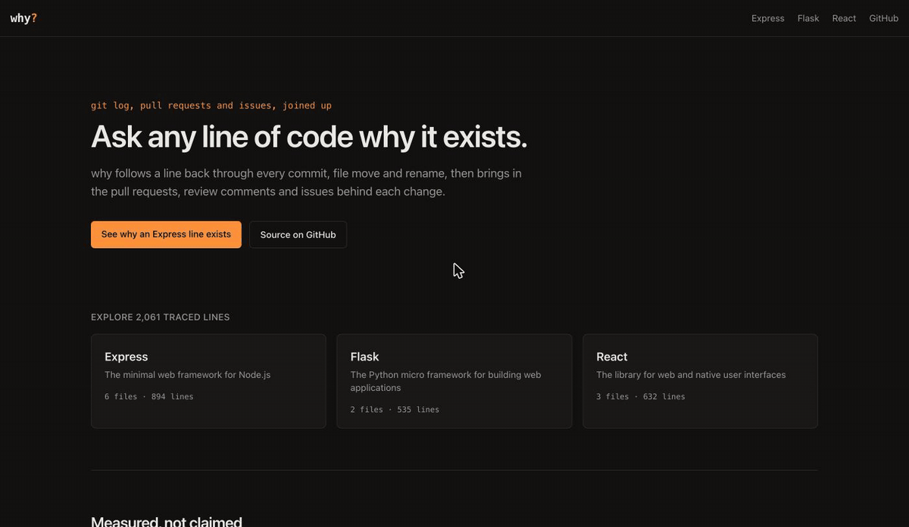

# why: line history

**Ask any line of code why it exists.**

Right-click a line and choose **Why does this line exist?** A side panel shows every commit that
shaped it, across edits, file moves and renames, with the pull request behind each change, what
reviewers said about that file and the issues it closed.

Works in VS Code, Cursor and Windsurf.

## Use it

- **Right-click** a line → **Why does this line exist?**
- Click **Why?** above any function or class
- Press **Ctrl+Alt+H** (**Ctrl+Cmd+H** on Mac)
- Or run **why: Why does this line exist?** from the Command Palette

Lines you changed but have not committed yet are mapped back to their place in the last commit;
a line you just typed tells you it has no history yet.

## GitHub

When the repository is on GitHub, each step shows its pull request, review comments on the file and
linked issues. GitHub allows 60 lookups an hour anonymously. Click **Sign in to GitHub** in the
panel (or run **why: Sign in to GitHub for more lookups**) to use the editor's built-in GitHub
login and get 5,000 an hour. Answers are cached on your computer.

## AI summary (optional)

Press **Explain with AI** in the panel for a short summary in which every claim cites a real
commit, pull request, review or issue, and the gaps the evidence does not cover are listed instead
of guessed.

| Setting                | Default      | What it does                                                                                                                                            |
| ---------------------- | ------------ | ------------------------------------------------------------------------------------------------------------------------------------------------------- |
| `why.ai.provider`      | `claude-cli` | `claude-cli` uses your Claude Code sign-in; `anthropic` uses an API key saved with **why: Set Anthropic API key** (kept in the editor's secret storage) |
| `why.ai.model`         | empty        | Model for the summary; empty means the provider's default                                                                                               |
| `why.codeLens.enabled` | `true`       | Show **Why?** above functions and classes                                                                                                               |

Nothing is sent to an AI unless you press the button.

## Requirements

`git` on your PATH. For `claude-cli` summaries, [Claude Code](https://claude.com/claude-code)
installed and signed in.

## More

[Live demo](https://zaynnnnnnn.github.io/why/) · [Source and accuracy results](https://github.com/ZaYnnnnnnn/why)
· MIT licensed
