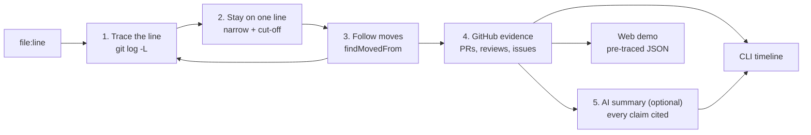

# How why works

This is the full walk-through. It follows one real line from Express through every step, explains
each problem we hit and how it was solved, and ends with a map of the code and a glossary. The
README has the short version.

The example line is `lib/response.js:65` in Express:

```js
res.status = function status(code) {
```

## The question

"Why does this line exist?" really means three smaller questions:

1. **When did it change, and how?** Every commit that touched this line, oldest to newest.
2. **Where did it come from?** The code may have been written somewhere else and moved here.
3. **What did people say?** The pull request, the reviewers' comments and the issue behind each
   change. This is usually where the real reason lives.

`why` answers them in that order, and each answer feeds the next.



## Step 1: Trace the line inside its file

Git already has a command that follows a range of lines back through history:

```bash
git log -L65,65:lib/response.js
```

For every commit that changed line 65, it prints the commit and a small diff of just that line. It
also handles the hard part of line numbers: when someone adds 10 lines above our line, our line
becomes line 75 in that older version, and git keeps track of that shift for us. Commits that only
shifted the line are skipped.

`why` runs this one command and turns its text output into data: for each step, the commit, author,
date, message, the line's text before and after, and whether the step **added** or **changed** the
line.

Two details make the parsing safe:

- We ask git for a custom format with invisible separator characters between fields, so a commit
  message containing any text at all cannot confuse the parser.
- A diff marks removed lines with `-`. A removed code line like `-- comment` therefore shows up as
  `--- comment`, which looks exactly like a diff header. The parser only reads headers _before_ the
  `@@` marker that starts the changed lines, so this cannot fool it.

Git is always run with its arguments as a list, never through a shell, and revisions that start
with `-` are rejected, so nothing a user types can turn into an extra command.

File renames come for free: `git log -L` already follows a file when it is renamed.

## Step 2: Stay on one line

Testing on real projects showed that `git log -L` does not always stay on one line.

**The range widens.** When an old commit collapsed 16 lines into our one line, git keeps tracking
all 16 old lines from that point back. The trail then fills up with changes to _neighbouring_
code. One Express trail grew to 45 steps, most of them about other lines.

**The fix:** whenever a step's "before" has more than one line, `why` picks the old line most
similar to ours and starts a fresh `git log -L` on that single line from the commit before. That
trail went from 45 steps to 5, all about the right line.

**Unrelated replacements.** Sometimes git calls a line "changed" when the old text did something
completely different, because git simply lined the two up in its diff. `why` measures how similar
the old and new text are (0 means nothing in common, 1 means identical). Below **0.5**, it decides
the line replaced unrelated code and ends the trail there.

That 0.5 was not guessed. It was chosen by running the accuracy test at many values (see "How we
know it works" below).

**How similarity is measured:** remove all spaces, cut both lines into pairs of neighbouring
characters, and count how many pairs they share. `limit = 10` and `limit = 50` share most pairs, so
they score high; `cleanupTempFiles(dir)` and `const limit = readLimit(config)` share almost none.

## Step 3: Follow moves

For our Express line, `git log -L` alone stops at a 2011 commit called "misc", and says the line was
_added_ there. That is wrong: the "misc" commit moved the whole `res.status` block from line 149
to line 39 of the same file. Git sees a move as "deleted here, added there".

So whenever a trail ends at an "added" step, `why` asks: **was this line really written here, or
moved here?** (`findMovedFrom` in the code.)

1. Collect every line **removed** in that same commit, in any file.
2. Look for one that matches our line:
   - the same text, ignoring spaces (so reformatted moves still match), or
   - very similar text (80% or more), but only if at least one neighbouring line moved with it.
3. Use the 3 lines above and below to choose between candidates. A short or common line like `}`
   only counts as moved if at least two neighbours match too, because `}` is everywhere.
4. If two candidates are equally good, **stop and say so** ("may have been moved from a.js:2 or
   b.js:2") instead of guessing. A wrong history is worse than a short one.
5. If there is one clear match, that step becomes **moved**, and the trace restarts from the
   commit before, at the old location (line 149). It repeats until it reaches a real origin, with a
   limit of 50 restarts and never the same place twice.

For our line, that gives the full story:

```text
bb53b20  2015-06-20  Douglas Christopher Wilson
  perf: remove argument reassignments in response prototype
  changed at line 58
  - res.status = function(code){
  + res.status = function status(code) {

61ce6c5  2011-11-10  Tj Holowaychuk
  misc
  moved to line 39 from lib/response.js:149

b04be51  2011-06-28  Tj Holowaychuk
  Added chainable res.status(code)
  added at line 143
  + res.status = function(code){
```

The real origin is "Added chainable res.status(code)", two weeks before the move.

## Step 4: Bring in the evidence from GitHub

Commit messages are short. The reasons are usually in the pull request and the issues. For every
step, `why` asks GitHub:

1. **Which pull request contains this commit?** GitHub has an endpoint for exactly this. If it
   knows none, `why` looks for `(#123)` at the end of the commit subject, which is how squash
   merges look.
2. **What did reviewers say about this file?** Review comments on the traced file only, oldest
   first. Comments on other files are left out.
3. **Which issues are linked?** From the commit message, the PR title and the PR description.
   `Closes #3143` and `fixes #12` count as **closes** (a strong link, the same words GitHub itself
   uses to close issues). Any other `#123` counts as **mentions**. Colour codes like `#fff`, URL
   fragments and HTML entities are ignored.

**Release pull requests.** Some pull requests bundle many commits, like Express's "Release 4.13"
with 40 commits. Their descriptions list issues about everything in the release, not this line. A
pull request counts as a **batch** if it has more than 20 commits _and_ the traced commit does not
mention its number. A batch is still shown, but its issue links are not attached to the line. (The
second condition matters: Express PR #4212 also has 30 commits, but its commit is called
"Throw on invalid status codes (#4212)", so it _is_ that pull request, not a release.)

**Being polite to GitHub.** Without a token GitHub allows 60 requests an hour; with a free
read-only token, 5,000. Every answer is cached on disk (`~/.cache/why/github`), so asking about the
same line twice makes no requests. A commit's pull request is cached forever once found, while pull
requests and issues are refreshed after a week. If the limit runs out, the trace still prints and
`why` explains when the limit resets. The token is only sent to GitHub and never saved.

## Step 5: The AI summary (optional)

With `--explain`, `why` writes a short summary on top of the evidence. The rule is simple: **every
claim must point at a real piece of evidence.**

1. **Build an evidence pack.** Everything from steps 1 to 4 becomes plain text, and every item
   gets an ID: `C1` for commits, `PR1` for pull requests, `R1` for review comments, `I1` for
   issues. If it is too long, issue comments are dropped first, then review comments, then long
   descriptions are shortened. Commits are never dropped.
2. **Ask the model for JSON:** a one or two sentence summary, a short timeline, a confidence level,
   and a list of **gaps**: things the evidence does not say. Gaps are often the most useful part,
   because they stop the model from guessing.
3. **Check every citation.** Every claim must cite at least one ID, and every ID must exist in the
   pack. If the answer fails, the model gets one retry with the exact problems listed. If it fails
   again, `why` shows the plain timeline instead of unchecked claims.

The evidence comes from strangers (anyone can write a PR description), so the prompt marks it as
data, not instructions, and the model runs with no tools. By default `why` uses your own Claude
Code sign-in (`claude -p`), in an empty temporary folder so the traced project's own settings are
never loaded. With `--ai anthropic` it uses your own API key instead. Answers are cached, so asking
again is instant.

The live demo does not show AI summaries yet; they will be added once a Claude account is
connected.

## The web demo

Running `why` live on a server would cost money and need protection against abuse. Instead, the
demo is **traced ahead of time**: a script runs steps 1 to 4 on 2,061 lines from Express, Flask and
React, and saves the results as JSON files. The site is built from those files and served for free
by GitHub Pages. Nothing runs on a server.

The data is stored so it stays small: commits, pull requests and issues are kept once per project
and referenced by ID, because one commit can touch hundreds of lines. Code colouring is done when
the site is built, so the browser downloads plain HTML instead of a colouring library.

## How we know it works

30 lines were picked at random (by a fixed seed, so nobody chose them) from Express, Flask and
React. For each one, the true history was worked out by hand using a **different method** from
`why`'s: searching the whole history for the exact text (`git log -S`) and reading every diff.
`pnpm eval` then scores `why` against those answers.

| Measure                                              | Result   |
| ---------------------------------------------------- | -------- |
| Trail ends at the true origin                        | 20 of 30 |
| Newest step is the last commit that touched the line | 30 of 30 |
| Trail follows the wrong line                         | 0 of 30  |

When `why` misses, it stops too early or goes one step too far; it never follows the wrong line.
The misses are code that was **copied** to a new file (followed by deleting the original later),
lines **split** into several by reformatting, big **rewrites**, and one line that was **reverted
and re-landed**. Each is explained in [decision 0007](decisions/0007-measuring-accuracy.md).

## Where the code lives

| What                                       | File                                    |
| ------------------------------------------ | --------------------------------------- |
| Safe git runner and clear errors           | `packages/core/src/git.ts`, `errors.ts` |
| Step 1 and 2: trace, narrow, cut-off       | `packages/core/src/traceLine.ts`        |
| Step 3: move detection                     | `packages/core/src/findMovedFrom.ts`    |
| Step 4: GitHub client, cache, links        | `packages/core/src/github/`             |
| Step 5: evidence pack, AI, citation checks | `packages/core/src/explain/`            |
| Command line                               | `apps/cli/src/`                         |
| Web demo and data generator                | `apps/web/`                             |
| Accuracy test                              | `eval/`                                 |
| Test repositories with a scripted history  | `packages/testkit/`                     |
| Why each choice was made                   | `docs/decisions/`                       |

## Glossary

- **Commit:** one saved change in git, with an author, a date and a message.
- **Diff:** the difference between two versions of a file; removed lines start with `-`, added
  lines with `+`.
- **Hunk:** one block of changes inside a diff, starting with an `@@` line.
- **`git log -L`:** git's command for following a range of lines through history.
- **`git log -S` (pickaxe):** finds the commits that added or removed a piece of text anywhere.
- **`git blame`:** shows, for each line, the last commit that changed it.
- **Pull request (PR):** a proposed change on GitHub, with a description, a discussion and
  reviews, merged into the project when approved.
- **Squash merge:** merging a whole pull request as one commit, usually titled `… (#123)`.
- **Issue:** a bug report or request on GitHub; a PR can close it.
- **Rate limit:** how many requests GitHub allows per hour.
- **Similarity:** how alike two lines are, from 0 (nothing shared) to 1 (identical).
- **Static site:** a website made only of files, with no server code running.
